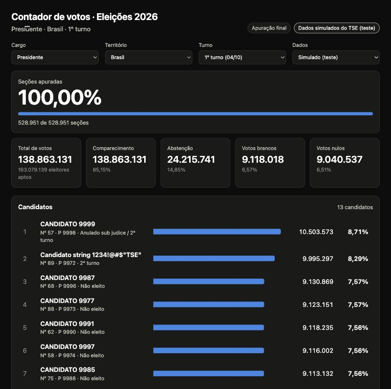
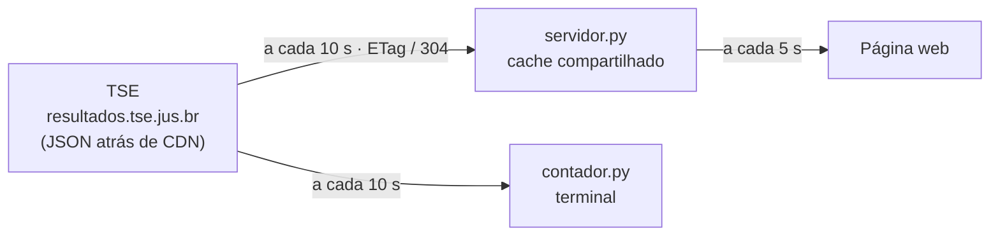

# 🗳️ Contador de votos · Eleições 2026

**Acompanhe a totalização do TSE quase em tempo real, no navegador ou no terminal.**




> A imagem usa os **dados simulados** que o TSE disponibiliza para teste. Os nomes são fictícios.

O programa **não conta votos**: ele lê os arquivos JSON de resultado que o TSE publica e mostra o placar. Só a divulgação oficial do TSE tem valor legal.

## Destaques

- Presidente, governador, senador e deputados federal, estadual e distrital, por UF, no 1º e no 2º turno.
- Página web com tema claro e escuro, boa no celular, que atualiza sozinha. O endereço guarda a seleção, então dá para compartilhar `?cargo=governador&uf=sp`.
- Placar no terminal para quem prefere.
- Um servidor consulta o TSE e reparte a resposta com todos os visitantes. Mais gente na página não aumenta o acesso ao TSE.
- Respeita as regras de acesso do TSE (veja [abaixo](#regras-de-acesso-do-tse)).
- Só biblioteca padrão do Python. Nada para instalar.

## Como rodar

### Com Docker

```bash
cp .env.example .env     # opcional: muda a porta (padrão 8000)
make up                  # ou: docker compose up -d --build
```

Abra <http://127.0.0.1:8000>. Para parar: `make down`. Para ver os logs: `make logs`.

A porta é publicada só em `127.0.0.1`. Para abrir ao público, veja [Colocar numa VPS](#colocar-numa-vps).

### Sem Docker

```bash
make web                 # ou: python3 servidor.py --porta 8000
```

### Colocar numa VPS

Precisa de Docker com o plugin Compose (`docker compose version`). Antes de tudo, confira que a VPS consegue ler o TSE, porque o TSE pode bloquear IP de datacenter:

```bash
curl -s -o /dev/null -w "%{http_code}\n" https://resultados.tse.jus.br/oficial/comum/config/ele-c.json   # deve dar 200
```

Do seu computador, mande os arquivos (sem Git):

```bash
rsync -az --filter=':- .gitignore' --exclude .git --exclude .claude --exclude docs ./ USUARIO@IP:~/contador/
```

Na VPS:

```bash
cd ~/contador
printf 'BIND=0.0.0.0\nPORTA=80\n' > .env
docker compose up -d --build
curl -s http://127.0.0.1/saude          # deve responder: ok
```

Abra `http://IP-DA-VPS`. Se usar o firewall `ufw`, libere a porta e mantenha o SSH: `sudo ufw allow OpenSSH && sudo ufw allow 80/tcp`. Se o provedor tem firewall próprio, libere a porta 80 lá também. É HTTP puro, sem HTTPS: serve para acompanhar dados públicos, mas não digite senhas em nada que você coloque neste endereço.

#### Com HTTPS num subdomínio (VPS que já tem Caddy)

Se a VPS já roda um Caddy nas portas 80/443 (o do `amazon_pay`), não use `PORTA=80`: conflita. Coloque o contador atrás dele, num subdomínio do domínio que você já tem, sem custo de domínio novo.

1. No DNS do domínio, crie um registro `A` do subdomínio (ex.: `votos`) apontando para o IP da VPS. Confira com `dig +short A votos.seudominio.com.br` antes de seguir: o Let's Encrypt valida pelo nome, e tentativa falha conta no limite dele.
2. No `.env` do `amazon_pay` na VPS, acrescente `VOTOS_ADDRESS=votos.seudominio.com.br`. O `Caddyfile` e o `docker-compose.yml` desse projeto já têm o bloco.
3. Aqui, em `~/contador`, suba com o override que põe o contador na rede do Caddy:

```bash
docker compose -f compose.yaml -f compose.vps.yaml up -d --build
```

4. Depois que `https://votos.seudominio.com.br` abrir, feche a porta pública antiga: tire `BIND` e `PORTA` do `.env` daqui (o padrão volta para `127.0.0.1`) e repita o comando acima.

### No terminal

```bash
python3 contador.py                              # presidente, Brasil
python3 contador.py -c governador --uf sp        # governador de São Paulo
python3 contador.py -c senador --uf mg --top 5   # senador de Minas, 5 primeiros
python3 contador.py -c governador --uf sp --cidade campinas   # só a cidade de Campinas
python3 contador.py --turno 2                    # segundo turno (25/10)
python3 contador.py --ambiente simulado          # dados de teste do TSE
```

| Opção | O que faz | Padrão |
|---|---|---|
| `-c`, `--cargo` | `presidente`, `governador`, `senador`, `deputado-federal`, `deputado-estadual`, `deputado-distrital` | `presidente` |
| `--uf` | sigla da UF; `br` só vale para presidente | `br` (presidente) |
| `--cidade` | nome da cidade (sem diferenciar acento nem caixa); precisa de `--uf` | todo o território |
| `--municipio` | código TSE da cidade (5 dígitos), alternativa a `--cidade` | todo o território |
| `--turno` | `1` ou `2` (só presidente e governador têm 2º turno) | `1` |
| `--ambiente` | `oficial` ou `simulado` (dados de teste do TSE) | `oficial` |
| `--top` | quantos candidatos mostrar | `15` |
| `--intervalo` | segundos entre consultas (mínimo 10) | `10` |
| `--uma-vez` | consulta uma vez e sai | desligado |

Antes da apuração começar, o arquivo oficial já existe com os candidatos e todos os votos zerados.

## Como funciona



### Atraso: é quase tempo real

Não existe voto a voto ao vivo. O TSE publica novos totais a cada totalização das urnas, e os arquivos passam por CDN.

Medindo o arquivo oficial, o CDN renova a cópia a cada cerca de 12 segundos, mas manda `max-age` de 17 a 54 segundos. Seguir esse `max-age` atrasaria o placar sem necessidade. Por isso o contador consulta o TSE a cada 10 segundos com `If-None-Match`: o TSE responde 304 quando nada mudou, são cerca de 6 consultas por minuto por seleção, bem abaixo do limite de 100 por segundo.

O atraso que o contador soma é de até uns 15 segundos. O resto depende de quando o TSE publica. A página e o terminal mostram o horário da última totalização do TSE para você conferir.

## API

`GET /api/resultado` devolve JSON. `GET /api/municipios` lista as cidades de uma UF, para montar um seletor.

| Parâmetro | Valores | Padrão |
|---|---|---|
| `cargo` | os mesmos da linha de comando | `presidente` |
| `uf` | sigla da UF, ou `br` para presidente | `br` (presidente) |
| `turno` | `1` ou `2` | `1` |
| `ambiente` | `oficial` ou `simulado` | `oficial` |
| `municipio` | código TSE da cidade (5 dígitos); só vale com `uf` diferente de `br` e só se o TSE listar a cidade nessa UF | UF inteira |
| `top` | de 1 a 100 candidatos | `15` |

`/api/municipios` aceita `cargo`, `uf`, `turno` e `ambiente` (a `uf` é obrigatória e não pode ser `br`) e devolve `{"uf": "sp", "municipios": [{"codigo": "62910", "nome": "Campinas", "capital": false}, ...]}`, em ordem alfabética. O servidor guarda a lista por 6 horas.

```json
{
  "final": false,
  "ultima_totalizacao": "04/10/2026 18:01:02",
  "secoes": { "total": 499248, "apuradas": 120000, "percentual": 24.04 },
  "eleitores": { "aptos": 158745502, "comparecimento": 30000000, "pct_comparecimento": 81.2 },
  "votos": { "total": 30000000, "brancos": 900000, "pct_brancos": 3.0, "nulos": 1500000, "pct_nulos": 5.0 },
  "total_candidatos": 12,
  "candidatos": [
    { "posicao": 1, "numero": "13", "nome": "NOME", "partido": "PT", "votos": 12000000, "percentual": 41.2, "eleito": false, "situacao": "" }
  ],
  "ambiente": "oficial",
  "municipio": null,
  "idade_s": 4
}
```

`municipio` vem `null` para a UF inteira, ou `{"codigo": "62910", "nome": "Campinas"}` quando a consulta é de uma cidade. Os números acima são só de exemplo e o JSON foi resumido (a resposta real traz também abstenção, horário de geração do arquivo e outros campos). Códigos de resposta: `200` com dados, `400` seleção inválida, `404` o TSE ainda não publicou, `503` o TSE não respondeu. Se o TSE falhar mas houver um placar antigo, ele é devolvido com o campo `aviso`. `GET /saude` responde `ok` (usado pelo healthcheck do Docker).

### Histórico e atualizações

`GET /api/historico` e `GET /api/atualizacoes` valem para presidente, governador e senador e aceitam `cargo`, `uf`, `turno`, `ambiente` e `municipio`, como `/api/resultado`. Eles **nunca consultam o TSE**: só devolvem o que o servidor já guardou. Cada vez que um visitante recebe uma totalização nova, o servidor guarda um ponto da série (por seleção, no máximo 600 pontos, 120 seleções e 12 candidatos por ponto). Sem visitantes, não há pontos.

```json
{
  "candidatos": [{ "numero": "13", "nome": "NOME", "partido": "PT" }],
  "pontos": [
    { "totalizacao": "25/10/2026 18:36:00", "percentual": 40.0, "apuradas": 230152, "secoes": 575382, "final": false,
      "placar": [["13", 17600574, 37.58, ""], ["22", 14901432, 31.82, ""]] }
  ]
}
```

Cada linha de `placar` é `[número, votos, percentual sobre os válidos, situação]` (situação: `""`, `"e"` eleito ou `"2"` vai ao 2º turno). A resposta traz até 120 pontos, escolhidos por igual do começo ao fim. `/api/atualizacoes` devolve `{"eventos": [{"hora", "tipo", "texto"}]}`, do mais novo para o mais antigo (até 40), com os tipos `inicio`, `totalizacao`, `lider`, `eleito`, `segundo_turno` e `final`. Seleção inválida dá `400`; seleção sem pontos dá listas vazias.

Para o histórico sobreviver a um reinício, defina `HISTORICO_DIR` (no Docker já vem configurado e gravado no volume `historico`). Os pontos vão para `historico.jsonl`, que para de crescer em 64 MB.

### Mapa, regiões e disputas

`GET /api/mapa` (presidente e governador), `GET /api/regioes` (presidente) e `GET /api/disputas` (governador e senador) aceitam `cargo`, `turno` e `ambiente`. Os três resumem os arquivos de **todas as UFs** de uma vez e dividem a mesma rodada de consultas: o servidor monta a resposta no máximo a cada 5 s e cada arquivo de UF fica 20 s no cache (29 arquivos por rodada no presidente: o nacional, as 27 UFs e o exterior).

`/api/mapa` devolve `ufs`, com uma entrada por UF:

```json
{
  "situacao": "lider",
  "lider":   { "numero": "13", "nome": "NOME", "partido": "PT", "votos": 1568731, "percentual": 47.49, "eleito": false, "segundo_turno": false },
  "segundo": { "numero": "22", "nome": "NOME", "partido": "PL", "votos": 1200000, "percentual": 36.3, "eleito": false, "segundo_turno": false },
  "margem": 11.19, "margem_votos": 368731,
  "secoes": { "total": 8078, "apuradas": 4039, "percentual": 50.0 }, "final": false,
  "disputa": { "situacao": "apurando", "entre": ["..."], "margem": 11.19, "margem_votos": 368731 }
}
```

`situacao` é `lider`, `zerado` (sem voto ou sem seção apurada), `empate` (no topo; traz `empatados`), `sem_dados` (o TSE não respondeu para a UF) ou `sem_segundo_turno` (governador no 2º turno, em UF decidida no 1º; traz `primeiro_turno`). Só `lider` tem líder: entre zeros ou empatados ninguém é escolhido. No presidente a resposta traz ainda `exterior` (a UF "zz" do TSE), `candidatos` (total do país) e, em cada UF, `votos` de todos os candidatos. `partidos` lista os partidos que aparecem no topo.

`/api/regioes` soma os votos de cada candidato por região (Norte, Nordeste, Centro-Oeste, Sudeste, Sul e Exterior) e devolve `{"regioes": [{"regiao", "ufs", "ufs_com_dados", "secoes", "votos", "lider", "candidatos"}]}` com os três mais votados de cada uma (percentual sobre os votos nominais somados).

`/api/disputas` devolve `{"disputas": [...]}` das corridas por menor diferença de votos: `entre` traz os dois candidatos que decidem a vaga (1º e 2º no governo; 2º e 3º no Senado, que tem 2 vagas por UF em 2026) e `situacao` é `apurando`, `eleito` ou `segundo_turno`. Ficam de fora as UFs sem disputa, sem dados e sem apuração iniciada.

Os contornos do mapa vêm da malha de UFs do IBGE, simplificada por `tools/gerar_mapa.py` e embutida na página (o servidor nunca acessa o IBGE). Para refazer: `python3 tools/gerar_mapa.py` e colar a saída no lugar de `MAPA_UFS` em `index.html`.

### Anúncio no topo

`GET /api/anuncio` devolve `{"ativo": false}` ou `{"ativo": true, "texto", "rotulo", "link"}` (o `link` só vem se for válido). A faixa aparece acima do título e some quando não há `ANUNCIO_TEXTO`. Configure no `.env` (veja `.env.example`): `ANUNCIO_TEXTO` (uma linha, até 160 caracteres), `ANUNCIO_LINK` (opcional, só `http://` ou `https://`) e `ANUNCIO_ROTULO` (opcional, padrão "Publicidade", sempre visível). O texto é exibido como texto puro, nunca como HTML, e o link abre em aba nova com `rel="sponsored noopener noreferrer"`. A configuração é lida na partida: mudou, reinicie.

## Regras de acesso do TSE

O TSE limita o acesso a 100 requisições por segundo por IP e bloqueia o IP por 10 minutos se o limite for passado ou se houver muitos erros 404 seguidos. Por isso:

- a consulta é no mínimo a cada 10 segundos e usa `If-None-Match` (ETag);
- o terminal encerra no primeiro 404, em vez de repetir (cargo, UF ou turno errado);
- o servidor web guarda o 404 por 60 segundos e, se passar de 10 em um minuto, para de tentar URLs novas por um tempo;
- o servidor só monta URLs a partir de valores conhecidos (cargo, UF, turno, ambiente e cidade validados contra a lista do TSE), então nada que o visitante digita vai parar na URL do TSE;
- cada cidade é uma consulta a mais, então o servidor faz no máximo 20 consultas por segundo ao TSE (sobra com folga do limite de 100) e guarda no máximo 400 seleções em memória, descartando as menos usadas;
- ao receber 403 ou 429, espera 10 minutos e continua mostrando o último placar.
- o mapa começa por um arquivo "sentinela" (o nacional, ou a primeira UF): se ele não vem, as outras UFs nem são consultadas. Depois vão no máximo 6 em paralelo, com pausa entre elas, e a rodada para ao ver 3 respostas 404 ou qualquer 403/429.

## Roadmap

Ideias levantadas a partir de uma análise de painéis concorrentes de apuração (o 2º turno é em 25/10, então a ordem importa). Vale reproduzir a **funcionalidade**, nunca o visual, os textos, a marca ou as fotos de terceiros.

Nosso diferencial: sem login, sem convite e sem e-mail obrigatório; API aberta; só biblioteca padrão do Python; respeito às regras de acesso do TSE.

### Prioridade 1 (antes do 2º turno)

1. **Evolução da apuração.** O servidor guarda um snapshot do placar a cada totalização nova (percentual de cada candidato por % de seções apuradas). A página mostra um gráfico de linhas "ao longo da apuração" e a API expõe a série (ex.: `GET /api/historico`). Guardar em memória com limite e, se der, em disco para sobreviver a reinício.
2. **Replay.** Linha do tempo com play sobre os snapshots do item 1, para rever a apuração do começo ao fim.
3. **Feed de atualizações.** Lista cronológica de eventos: "+N seções", variação do placar, candidato eleito, disputa que foi para o 2º turno. Gerar comparando um snapshot com o anterior.
4. **Mapa por UF.** Mapa do Brasil colorido pelo líder de cada UF, com intensidade pela margem e clique que seleciona a UF. Usar SVG embutido, sem dependência externa.

### Prioridade 2

5. **Compartilhar com imagem.** Meta tags Open Graph por seleção (`?cargo=...&uf=...`) e imagem gerada no servidor, para o link abrir com prévia no WhatsApp e no X.
6. **PWA e alerta.** `manifest` e service worker para instalar no celular; notificação quando a apuração começar ou o resultado ficar definido.
7. **Painel por região** (Norte, Nordeste, Centro-Oeste, Sudeste, Sul, Exterior) no placar de presidente.
8. **Disputas mais apertadas.** Ranking de governador e senador por menor margem, com selo de "eleito" e "2º turno".
9. **Busca rápida** (atalho `/` ou `⌘K`) por UF, cidade e candidato.
10. **Resumo do placar:** diferença em pontos e em votos; comparecimento, brancos e nulos em destaque.

### Prioridade 3

11. **Hemiciclo** da Câmara e do Senado, com contagem por partido e bloco.
12. **Mais votados do Brasil** em deputado federal e estadual.
13. **Comparar** duas cidades ou dois cargos lado a lado.
14. **Exportar** CSV e JSON do que está na tela.
15. **Mapa por município.** Depende de geometria das cidades (arquivo GeoJSON pesado), por isso fica por último. Tratar a falha de carregamento com aviso claro e nova tentativa.
16. **Tela cheia** e indicador "ao vivo" com a idade do dado (`idade_s` já existe na API).

### Regras para quem implementar

- Não aumentar o acesso ao TSE: tudo novo sai do cache e dos snapshots do servidor.
- Manter a página num arquivo só, sem dependência de CDN, e o tema claro e escuro.
- Cada item novo ganha teste em `test_servidor.py` ou `test_contador.py`.
- Atualizar a seção [API](#api) quando criar endpoint.

## Estrutura

```
contador.py        leitura do TSE e placar no terminal
servidor.py        servidor web: cache compartilhado e API
index.html         página (HTML, CSS e JS num arquivo só)
test_*.py          testes (unittest)
Dockerfile         imagem da página web
compose.yaml       sobe a página web com Docker
Makefile           atalhos: make up, make web, make teste
docs/painel.jpg    imagem usada neste README
```

## Desenvolvimento

```bash
make teste               # ou: python3 -m unittest -v
```

Os testes não acessam a internet. A CI (`.github/workflows/ci.yml`) roda os testes no Python 3.9 e 3.12 e constrói a imagem Docker.

Limites conhecidos:

- Não verifica a assinatura JWS dos arquivos do TSE (veja o manual na página abaixo).
- Os arquivos do 2º turno só existem depois que o TSE os publica; antes disso a página avisa que ainda não há resultado.

## Fontes

- Especificação dos arquivos e códigos das eleições: <https://www.tse.jus.br/eleicoes/informacoes-tecnicas-sobre-a-divulgacao-de-resultados>
- Resultados no navegador: <https://resultados.tse.jus.br>
