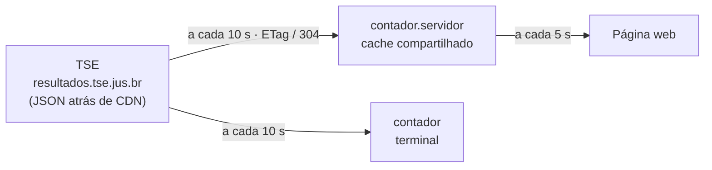

# 🗳️ Contador de votos · Eleições 2026

**Acompanhe a totalização do TSE quase em tempo real, no navegador ou no terminal.**


> A imagem usa os **dados simulados** que o TSE disponibiliza para teste. Os nomes são fictícios.

O programa **não conta votos**: ele lê os arquivos JSON de resultado que o TSE publica e mostra o placar. Só a divulgação oficial do TSE tem valor legal.

## Destaques

- Presidente, governador, senador e deputados federal, estadual e distrital, por UF, no 1º e no 2º turno.
- Página web com tema claro e escuro, boa no celular, que atualiza sozinha. O endereço guarda a seleção, então dá para compartilhar `?cargo=governador&uf=sp`.
- Placar no terminal para quem prefere.
- Um servidor consulta o TSE e reparte a resposta com todos os visitantes. Mais gente na página não aumenta o acesso ao TSE.
- Respeita as regras de acesso do TSE (veja [abaixo](#regras-de-acesso-do-tse)).
- Evolução da apuração com replay, feed de atualizações, resumo da diferença, indicador "ao vivo" e tela cheia para TV.
- Mapa do Brasil colorido pelo líder de cada UF, painel por região, disputas mais apertadas, mapa por município e mapa-múndi com o voto no exterior por país.
- Hemiciclo da Câmara (por partido e federação) e do Senado, e os mais votados de deputado federal e estadual.
- Busca rápida (`/` ou `⌘K`), comparação lado a lado, exportação em CSV e JSON, link com prévia e imagem, app instalável e alertas.
- Só biblioteca padrão do Python. Nada para instalar.

## Como rodar

### Com Docker

```bash
cp .env.example .env     # opcional: muda a porta (padrão 8000)
make up                  # ou: docker compose up -d --build
```

Abra <http://127.0.0.1:8000>. Para parar: `make down`. Para ver os logs: `make logs`.

A porta é publicada só em `127.0.0.1`. Para abrir ao público, veja [Colocar numa VPS](#colocar-numa-vps).

### Sem Docker

```bash
make web                 # ou: python3 -m contador.servidor --porta 8000
make demo                # TSE de mentira, a apuração avança sozinha, sem rede (ou: python3 -m contador.demo)
```

### Colocar numa VPS

Precisa de Docker com o plugin Compose (`docker compose version`). Antes de tudo, confira que a VPS consegue ler o TSE, porque o TSE pode bloquear IP de datacenter:

```bash
curl -s -o /dev/null -w "%{http_code}\n" https://resultados.tse.jus.br/oficial/comum/config/ele-c.json   # deve dar 200
```

Do seu computador, mande os arquivos (sem Git):

```bash
rsync -az --filter=':- .gitignore' --exclude .git --exclude .claude --exclude docs ./ USUARIO@IP:~/contador/
```

Na VPS:

```bash
cd ~/contador
printf 'BIND=0.0.0.0\nPORTA=80\n' > .env
docker compose up -d --build
curl -s http://127.0.0.1/saude          # deve responder: ok
```

Abra `http://IP-DA-VPS`. Se usar o firewall `ufw`, libere a porta e mantenha o SSH: `sudo ufw allow OpenSSH && sudo ufw allow 80/tcp`. Se o provedor tem firewall próprio, libere a porta 80 lá também. É HTTP puro, sem HTTPS: serve para acompanhar dados públicos, mas não digite senhas em nada que você coloque neste endereço.

#### Com HTTPS num subdomínio (VPS que já tem Caddy)

Se a VPS já roda um Caddy nas portas 80/443 (o do `amazon_pay`), não use `PORTA=80`: conflita. Coloque o contador atrás dele, num subdomínio do domínio que você já tem, sem custo de domínio novo.

1. No DNS do domínio, crie um registro `A` do subdomínio (ex.: `votos`) apontando para o IP da VPS. Confira com `dig +short A votos.seudominio.com.br` antes de seguir: o Let's Encrypt valida pelo nome, e tentativa falha conta no limite dele.
2. No `.env` do `amazon_pay` na VPS, acrescente `VOTOS_ADDRESS=votos.seudominio.com.br`. O `Caddyfile` e o `docker-compose.yml` desse projeto já têm o bloco.
3. Aqui, em `~/contador`, suba com o override que põe o contador na rede do Caddy:

```bash
docker compose -f compose.yaml -f compose.vps.yaml up -d --build
```

4. Depois que `https://votos.seudominio.com.br` abrir, feche a porta pública antiga: tire `BIND` e `PORTA` do `.env` daqui (o padrão volta para `127.0.0.1`) e repita o comando acima.

### Deploy automático (GitHub Actions)

Toda vez que um commit entra na `main` e a CI (workflow **CI**) passa, o workflow **Deploy** (`.github/workflows/deploy.yml`) atualiza a VPS sozinho:

1. Entra na VPS por SSH com uma chave só para isso e roda `deploy/deploy.sh <sha> <pasta>` (o script vem do próprio repositório, por stdin).
2. Na VPS, o script anota o commit que está no ar, confere que o novo está na `main`, faz `git reset --hard <sha>` e `docker compose -f compose.yaml -f compose.vps.yaml up -d --build`.
3. Espera o contêiner ficar `healthy` (até 2 min). Se não ficar, **volta ao commit anterior**, sobe de novo e faz o job falhar, para o erro aparecer em vermelho no GitHub. O log mostra o commit de antes e o de agora.
4. Opcional: se a variável `PRODUCAO_URL` existir, o Actions confere `/saude` pela internet no fim.

Só dispara com CI verde, em `push` na `main` deste repositório (nunca em PR nem em fork), e um deploy por vez. O `.env` da VPS nunca é lido nem aparece no log. Quem consegue mergear na `main` coloca coisa no ar: ative em Settings > Branches a proteção da `main` (exigir PR e a CI verde).

**O que você precisa fazer uma vez** (nada disso fica no repositório):

1. **Chave SSH só para o deploy.** No seu computador: `ssh-keygen -t ed25519 -f ~/.ssh/vote_count_deploy -C "deploy vote_count" -N ""`. Na VPS, acrescente a linha pública em `~/.ssh/authorized_keys` do usuário que roda o Docker, com restrições: `no-port-forwarding,no-agent-forwarding,no-X11-forwarding,no-pty ssh-ed25519 AAAA... deploy vote_count` (o conteúdo de `~/.ssh/vote_count_deploy.pub` vem depois das restrições). Atenção: quem acessa o Docker é equivalente a root na VPS, então guarde a chave privada só no secret do GitHub.
2. **`known_hosts` do servidor**, para o SSH não aceitar um servidor falso: `ssh-keyscan -t ed25519 IP-DA-VPS` e confira a impressão digital com a que a própria VPS mostra em `ssh-keygen -lf /etc/ssh/ssh_host_ed25519_key.pub` antes de copiar. Se o SSH não usa a porta 22: `ssh-keyscan -p PORTA -t ed25519 IP-DA-VPS`.
3. **Environment `production`** em Settings > Environments > New environment (se quiser, marque "Required reviewers" para o deploy esperar o seu aprovar). Nele, em **Environment secrets**:

| Secret | Valor |
|---|---|
| `VPS_HOST` | IP ou nome da VPS |
| `VPS_USER` | usuário do SSH (precisa usar o Docker sem `sudo`) |
| `VPS_PATH` | pasta do projeto na VPS (hoje `~/contador`; use o caminho completo, ex.: `/home/usuario/contador`) |
| `VPS_SSH_KEY` | o conteúdo inteiro da chave **privada** `~/.ssh/vote_count_deploy` (com as linhas `BEGIN` e `END`) |
| `VPS_KNOWN_HOSTS` | a saída do `ssh-keyscan` do passo 2 |
| `VPS_PORT` | opcional, só se o SSH não usa a 22 |

4. **Variáveis** (Settings > Secrets and variables > Actions > Variables, opcionais): `PRODUCAO_URL` (ex.: `https://votos.seudominio.com.br`, para a conferência de `/saude` pela internet) e `DEPLOY_AUTOMATICO`.
5. **Na VPS**, a pasta do projeto precisa ser um clone git do repositório com `origin` apontando para ele (o repositório é público, então o endereço `https://github.com/leonardoopa/vote_count.git` basta) e com o `.env` já criado. Alterações feitas à mão em arquivos versionados na VPS somem a cada deploy (o `.env` não: o git o ignora).
6. **Teste**: Actions > Deploy > Run workflow (deixe o commit vazio para usar a ponta da `main`). O workflow só dispara sozinho depois que `deploy.yml` estiver na `main`.

**Rollback.** Automático se o contêiner não ficar saudável. Para voltar de propósito a um commit antigo da `main`: Actions > Deploy > Run workflow e cole o SHA completo (40 caracteres) dele. Ou, direto na VPS, na pasta do projeto: `bash deploy/deploy.sh <sha> "$PWD"` (`FORCAR=1` refaz mesmo que o commit já esteja no ar).

**Desligar.** Crie a variável `DEPLOY_AUTOMATICO` com o valor `false` (vale também para o disparo manual) e apague-a para religar. Para cortar o acesso de vez, remova a linha da chave do `authorized_keys` da VPS ou apague os secrets.

### No terminal

```bash
python3 -m contador                              # presidente, Brasil
python3 -m contador -c governador --uf sp        # governador de São Paulo
python3 -m contador -c senador --uf mg --top 5   # senador de Minas, 5 primeiros
python3 -m contador -c governador --uf sp --cidade campinas   # só a cidade de Campinas
python3 -m contador --turno 2                    # segundo turno (25/10)
python3 -m contador --ambiente simulado          # dados de teste do TSE
```

| Opção | O que faz | Padrão |
|---|---|---|
| `-c`, `--cargo` | `presidente`, `governador`, `senador`, `deputado-federal`, `deputado-estadual`, `deputado-distrital` | `presidente` |
| `--uf` | sigla da UF; `br` só vale para presidente | `br` (presidente) |
| `--cidade` | nome da cidade (sem diferenciar acento nem caixa); precisa de `--uf` | todo o território |
| `--municipio` | código TSE da cidade (5 dígitos), alternativa a `--cidade` | todo o território |
| `--turno` | `1` ou `2` (só presidente e governador têm 2º turno) | `1` |
| `--ambiente` | `oficial` ou `simulado` (dados de teste do TSE) | `oficial` |
| `--top` | quantos candidatos mostrar | `15` |
| `--intervalo` | segundos entre consultas (mínimo 10) | `10` |
| `--uma-vez` | consulta uma vez e sai | desligado |

Antes da apuração começar, o arquivo oficial já existe com os candidatos e todos os votos zerados.

## Como funciona



### A página: um mapa só

A página é um painel de **tela única**: tem a altura da janela e a página nunca rola (só o que passa da janela rola dentro do próprio bloco). No topo ficam as abas por cargo (Presidente, Governador, Senado, Deputados, com Federal, Estadual e Distrital dentro dela), os filtros e a faixa do duelo com os dois primeiros, que fica fixa em todas as telas. Em tela larga (1180 px ou mais) aparecem três colunas juntas: o placar à esquerda (progresso, resumo, evolução e ranking com fotos), o **mapa** no centro, que ocupa a altura que sobra, e as regiões, as disputas e o feed à direita. No celular uma barra embaixo troca entre quatro telas (`web/js/telas.js`): **Mapa** (ou Hemiciclo, nos deputados), **Placar**, **Detalhes** (regiões, disputas, candidato) e **Ao vivo** (evolução, feed e a fonte); uma tela sem nada para mostrar some da barra. Cada bloco de `web/index.html` diz a que tela pertence em `data-na-tela`. O desenho dos mapas é dimensionado pela proporção (`--proporcao`) e por container queries, então cabe na tela sem barras nem rolagem; no modo incorporado (`?embed=1`) a página segue o fluxo normal.

Quem entra sem `turno` no endereço cai no **2º turno** (o que as pessoas vêm ver). Se o cargo não tiver 2º turno ainda (governador em estado sem segundo turno), a página mostra o 1º sozinha; escolher o turno no filtro vale daí em diante, e `?turno=1` abre o 1º.

O mapa do centro tem três vistas, e só a que está na tela busca dados no servidor:

- **Brasil:** os estados coloridos pelo partido do líder (mais forte quanto maior a margem). A cada rodada o desenho só troca as cores, com transição, e o estado que mudou pisca de leve.
- **Estado:** clicar num estado dá zoom animado até ele, os outros apagam e entra o mapa dos municípios, que enche aos poucos conforme o varredor busca as cidades. Clicar numa cidade dá outro zoom até ela e o placar passa a ser o da cidade.
- **Municípios (o modo padrão do Brasil):** os ~5,6 mil municípios pintados de azul e vermelho, como no painel do TSE, com o contorno dos estados por cima, o percentual do líder escrito em cada estado e uma etiqueta ao lado do mapa, com linha até o estado, para os pequenos do litoral e para o Exterior. Cada município nasce com a cor do estado dele, que chega logo, e troca pela própria cor conforme o varredor busca as cidades: o mapa vai se afinando sozinho ("N de 5.571 municípios"). Os outros modos ficam ao lado: **Apurado** (quanto das seções de cada município já foi apurado), **Vantagem** (um pico por município, da altura da vantagem em votos de quem lidera, no menu "Mais mapas") e **Estados** (a pintura por estado). Passar o mouse num município, estado ou etiqueta abre um cartão com o selo do lugar e os dois primeiros colocados, com foto, percentual e votos; ele some quando o ponteiro sai do mapa.
- **Candidato (só presidente):** tocar na foto de um candidato no duelo do topo (ou escolher o nome dele em "Mais mapas") pinta o mapa com a votação dele em cada município, na cor do partido, mais forte quanto mais votos válidos (a escala vai do 5º ao 95º percentil e aparece na legenda). Os estados mostram o percentual dele, e um painel à direita traz a votação nacional, os votos, a situação e os 5 estados onde ele foi melhor e os 3 onde foi pior. Tocar de novo na foto, ou em "Voltar", volta ao mapa por município. O servidor manda só o líder e o segundo de cada cidade, então onde o candidato ficou de fora dos dois primeiros (só no 1º turno) o município fica apagado.
- **Desempenho:** os municípios são desenhados num `<canvas>` por baixo do SVG dos estados (o SVG fica só com os contornos, as siglas e as etiquetas). Com 5,6 mil elementos SVG o carregamento travava a página por uns 4 segundos (medido com o Chrome em modo sem janela); no canvas a página não tem nenhuma tarefa longa, e redesenhar tudo, inclusive durante o zoom, custa poucos milissegundos. O canvas tem um `Path2D` por município, montado em lotes por quadro, e o município sob o mouse sai de um filtro por retângulo seguido de `isPointInPath`. O desenho (`web/geo/brasil.json`, gerado por `python3 tools/gerar_mapa.py --brasil web/geo`, com o centro de cada município para os picos) está nas mesmas coordenadas dos contornos dos estados.
- **Exterior:** o botão "Exterior" troca o mapa pelo mapa-múndi, na mesma posição. A trilha "Brasil › Estado › Cidade" (ou "Brasil › Exterior › País") volta um passo.

**Mapa ao vivo** (`web/js/mapa-ao-vivo.js`). Na primeira pintura os estados acendem do oeste para o leste; onde chegou voto novo sai uma onda do centro do estado, maior (e com o estado piscando) quando o líder mudou. **Rever a noite** toca as fotos do mapa que o servidor guardou (`/api/mapa-historico`): os estados trocam de cor na ordem em que aconteceu, com a contagem de estados por partido naquele instante, linha do tempo para arrastar e "Voltar ao vivo". Quem prefere menos movimento não vê as ondas nem a entrada. Os cartões da coluna do meio (mapas, mapa-múndi, hemiciclo, mais votados) são telas escuras nos dois temas: trocam os tokens de tema pelos do tema escuro, e os números grandes usam uma serifa do sistema, sem baixar fonte.

**Compartilhar** abre o link da tela (cargo, estado, cidade, turno e, se estiver aberta, a comparação: `?comparar=cargo:uf:turno[:município]`) e o código para **incorporar** o placar em outro site: um `<iframe>` com `?embed=1`. A página incorporada mostra só o título, o duelo, o progresso, o resumo e o ranking, atualiza sozinha, não traz anúncio, mapas nem service worker, sai dos buscadores (`noindex`) e termina com a fonte e um link de volta. O servidor já devolve o HTML com a classe `embed`, então a página não pisca.

### Atraso: é quase tempo real

Não existe voto a voto ao vivo. O TSE publica novos totais a cada totalização das urnas, e os arquivos passam por CDN.

Medindo o arquivo oficial, o CDN renova a cópia a cada cerca de 12 segundos, mas manda `max-age` de 17 a 54 segundos. Seguir esse `max-age` atrasaria o placar sem necessidade. Por isso o contador consulta o TSE a cada 10 segundos com `If-None-Match`: o TSE responde 304 quando nada mudou, são cerca de 6 consultas por minuto por seleção, bem abaixo do limite de 100 por segundo.

O atraso que o contador soma é de até uns 15 segundos. O resto depende de quando o TSE publica. A página e o terminal mostram o horário da última totalização do TSE para você conferir.

## API

`GET /api/resultado` devolve JSON. `GET /api/municipios` lista as cidades de uma UF, para montar um seletor.

| Parâmetro | Valores | Padrão |
|---|---|---|
| `cargo` | os mesmos da linha de comando | `presidente` |
| `uf` | sigla da UF, ou `br` para presidente | `br` (presidente) |
| `turno` | `1` ou `2` | `1` |
| `ambiente` | `oficial` ou `simulado` | `oficial` |
| `municipio` | código TSE da cidade (5 dígitos); só vale com `uf` diferente de `br` e só se o TSE listar a cidade nessa UF | UF inteira |
| `top` | de 1 a 100 candidatos | `15` |

`/api/municipios` aceita `cargo`, `uf`, `turno` e `ambiente` (a `uf` é obrigatória e não pode ser `br`) e devolve `{"uf": "sp", "municipios": [{"codigo": "62910", "nome": "Campinas", "capital": false}, ...]}`, em ordem alfabética. O servidor guarda a lista por 6 horas.

```json
{
  "final": false,
  "ultima_totalizacao": "04/10/2026 18:01:02",
  "secoes": { "total": 499248, "apuradas": 120000, "percentual": 24.04 },
  "eleitores": { "aptos": 158745502, "comparecimento": 30000000, "pct_comparecimento": 81.2 },
  "votos": { "total": 30000000, "brancos": 900000, "pct_brancos": 3.0, "nulos": 1500000, "pct_nulos": 5.0 },
  "total_candidatos": 12,
  "candidatos": [
    { "posicao": 1, "numero": "13", "nome": "NOME", "partido": "PT", "votos": 12000000, "percentual": 41.2, "eleito": false, "situacao": "", "foto": "https://resultados.tse.jus.br/oficial/ele2026/6257/fotos/br/280002551544.jpeg" }
  ],
  "ambiente": "oficial",
  "municipio": null,
  "idade_s": 4
}
```

`foto` é o endereço da foto do candidato no TSE (`null` quando o arquivo não traz o `sqcand`, como no ambiente simulado): a página baixa a imagem direto de lá, sem passar pelo servidor, e mostra as iniciais se ela não carregar. O ranking dos mais votados (`/api/maisvotados`) traz o mesmo campo. `municipio` vem `null` para a UF inteira, ou `{"codigo": "62910", "nome": "Campinas"}` quando a consulta é de uma cidade. Os números acima são só de exemplo e o JSON foi resumido (a resposta real traz também abstenção, horário de geração do arquivo e outros campos). Códigos de resposta: `200` com dados, `400` seleção inválida, `404` o TSE ainda não publicou, `503` o TSE não respondeu. Se o TSE falhar mas houver um placar antigo, ele é devolvido com o campo `aviso`. `GET /saude` responde `ok` (usado pelo healthcheck do Docker).

### Histórico e atualizações

`GET /api/historico` e `GET /api/atualizacoes` valem para presidente, governador e senador e aceitam `cargo`, `uf`, `turno`, `ambiente` e `municipio`, como `/api/resultado`. Eles **nunca consultam o TSE**: só devolvem o que o servidor já guardou. Cada vez que um visitante recebe uma totalização nova, o servidor guarda um ponto da série (por seleção, no máximo 600 pontos, 120 seleções e 12 candidatos por ponto). Sem visitantes, não há pontos.

```json
{
  "candidatos": [{ "numero": "13", "nome": "NOME", "partido": "PT" }],
  "pontos": [
    { "totalizacao": "25/10/2026 18:36:00", "percentual": 40.0, "apuradas": 230152, "secoes": 575382, "final": false,
      "placar": [["13", 17600574, 37.58, ""], ["22", 14901432, 31.82, ""]] }
  ]
}
```

Cada linha de `placar` é `[número, votos, percentual sobre os válidos, situação]` (situação: `""`, `"e"` eleito ou `"2"` vai ao 2º turno). A resposta traz até 120 pontos, escolhidos por igual do começo ao fim. `/api/atualizacoes` devolve `{"eventos": [{"hora", "tipo", "texto"}]}`, do mais novo para o mais antigo (até 40), com os tipos `inicio`, `totalizacao`, `lider`, `eleito`, `segundo_turno` e `final`. Seleção inválida dá `400`; seleção sem pontos dá listas vazias.

Para o histórico sobreviver a um reinício, defina `HISTORICO_DIR` (no Docker já vem configurado e gravado no volume `historico`). Os pontos vão para `historico.jsonl`, que para de crescer em 64 MB.

### Mapa, regiões e disputas

`GET /api/mapa` (presidente e governador), `GET /api/regioes` (presidente) e `GET /api/disputas` (governador e senador) aceitam `cargo`, `turno` e `ambiente`. Os três resumem os arquivos de **todas as UFs** de uma vez e dividem a mesma rodada de consultas: o servidor monta a resposta no máximo a cada 5 s e cada arquivo de UF fica 20 s no cache (29 arquivos por rodada no presidente: o nacional, as 27 UFs e o exterior).

`/api/mapa` devolve `ufs`, com uma entrada por UF:

```json
{
  "situacao": "lider",
  "lider":   { "numero": "13", "nome": "NOME", "partido": "PT", "votos": 1568731, "percentual": 47.49, "eleito": false, "segundo_turno": false },
  "segundo": { "numero": "22", "nome": "NOME", "partido": "PL", "votos": 1200000, "percentual": 36.3, "eleito": false, "segundo_turno": false },
  "margem": 11.19, "margem_votos": 368731,
  "secoes": { "total": 8078, "apuradas": 4039, "percentual": 50.0 }, "final": false,
  "disputa": { "situacao": "apurando", "entre": ["..."], "margem": 11.19, "margem_votos": 368731 }
}
```

`situacao` é `lider`, `zerado` (sem voto ou sem seção apurada), `empate` (no topo; traz `empatados`), `sem_dados` (o TSE não respondeu para a UF) ou `sem_segundo_turno` (governador no 2º turno, em UF decidida no 1º; traz `primeiro_turno`). Só `lider` tem líder: entre zeros ou empatados ninguém é escolhido. No presidente a resposta traz ainda `exterior` (a UF "zz" do TSE), `candidatos` (total do país) e, em cada UF, `votos` de todos os candidatos. `partidos` lista os partidos que aparecem no topo.

`/api/regioes` soma os votos de cada candidato por região (Norte, Nordeste, Centro-Oeste, Sudeste, Sul e Exterior) e devolve `{"regioes": [{"regiao", "ufs", "ufs_com_dados", "secoes", "votos", "lider", "candidatos"}]}` com os três mais votados de cada uma (percentual sobre os votos nominais somados).

`/api/disputas` devolve `{"disputas": [...]}` das corridas por menor diferença de votos: `entre` traz os dois candidatos que decidem a vaga (1º e 2º no governo; 2º e 3º no Senado, que tem 2 vagas por UF em 2026) e `situacao` é `apurando`, `eleito` ou `segundo_turno`. Ficam de fora as UFs sem disputa, sem dados e sem apuração iniciada.

Os contornos do mapa vêm da malha de UFs do IBGE, simplificada por `tools/gerar_mapa.py` e gravada em `web/js/contornos-ufs.js` (o servidor nunca acessa o IBGE). Para refazer: `python3 tools/gerar_mapa.py > web/js/contornos-ufs.js`.

`GET /api/mapa-historico` (presidente e governador; `cargo`, `turno` e `ambiente`) devolve `{"fotos": [{"t": segundos, "ufs": {"sp": ["PT", 12.3, 55.5]}}]}`, da mais antiga para a mais nova: para cada UF, o partido do líder (vazio se não há líder), a margem e o percentual das seções. O servidor guarda uma foto a cada mudança do mapa, só em memória (até 240 por seleção, 12 seleções), e devolve no máximo 120 espalhadas por igual. Só lê o que já foi guardado: nunca consulta o TSE. Sem visitantes não há fotos.

### Hemiciclo e mais votados

`GET /api/senado` (aceita `ambiente`) devolve o hemiciclo do Senado: em 2026 disputam-se 54 das 81 cadeiras (2 por UF) e cada uma vem como `eleito`, `liderando` (líder ainda sem "Eleito" do TSE) ou `indefinida` (UF sem apuração), em `cadeiras: [{"uf", "partido", "nome", "situacao"}]`, mais `partidos: [{"partido", "eleitos", "liderando"}]`. Usa a mesma rodada de consultas do mapa (as 27 UFs do senador). As outras 27 cadeiras não estão em jogo e o TSE não as publica.

`GET /api/camara` (aceita `ambiente`) devolve o hemiciclo da Câmara: `partidos: [{"partido", "cadeiras", "bloco"}]`, `blocos: [{"bloco", "federacao", "partidos", "cadeiras"}]` (cada bloco é uma federação do TSE ou um partido isolado), `eleitos`, `total` (513) e `ufs_com_dados` de `ufs_total`. `GET /api/maisvotados` (aceita `cargo`: `deputado-federal`, `deputado-estadual` ou `deputado-distrital`, e `ambiente`) devolve os 20 mais votados do país em `candidatos`, com `ufs_com_dados` de `ufs_total`; estadual e distrital formam um ranking só. Eleitos são os que o TSE marca como "Eleito" no arquivo.

Esses dois precisam de um arquivo de deputados por UF (27 por cargo). Quem busca é o **varredor** (`contador/varredor.py`): uma thread (acima de 5 buscas por segundo entram mais, até 8, porque uma só não passa de uns 3 por segundo: a rede demora), no máximo `BUSCAS_EXTRAS_POR_SEGUNDO` buscas por segundo no total, somando todas (padrão 2, contra o limite de 100 do TSE; `0` desliga os recursos e as rotas dão `503`), só enquanto alguém está olhando (5 min sem ninguém, a thread encerra), com `If-None-Match` (o TSE responde 304 sem corpo) e guardando só um resumo de cada UF. Um `403` ou `429` pausa tudo por 10 minutos e 3 respostas `404` seguidas pausam por 1 minuto. As respostas **enchem aos poucos** (`ufs_com_dados` cresce a cada busca); depois de apurada, cada UF é revista a cada 30 minutos, e antes disso a cada 90 s.

### Mapa por município

`GET /api/mapa-municipal` (presidente e governador, dentro de um estado: `cargo`, `uf`, `turno`, `ambiente` e, opcional, `foco`) devolve o líder de cada cidade da UF por código IBGE: `{"uf", "total", "carregadas", "idade_s", "cidades": {"3550308": {"nome", "codigo", "situacao", "lider", "margem", "margem_votos", "apurado", "final"}}}`. O TSE publica **um arquivo por cidade** (645 em SP), então as cidades são buscadas pelo mesmo varredor do hemiciclo, aos poucos (no máximo `BUSCAS_EXTRAS_POR_SEGUNDO`, padrão 2), e `carregadas` cresce a cada rodada; cada cidade é revista a cada 2 min (30 min depois de apurada), o que em SP significa uns 5 min por volta completa. Por isso a página manda em `foco` os códigos IBGE (até 60, separados por vírgula) das cidades que estão na tela com zoom, as mais perto do centro primeiro: o varredor busca essas antes das outras por 90 s (`FOCO_S`), sem passar do mesmo teto. Com `uf=br` (presidente e governador) devolve o país inteiro, em listas curtas para caber: `{"total", "carregadas", "idade_s", "candidatos": [{"numero", "nome", "partido", "foto"}], "cidades": {"2611606": [líder, % do líder, segundo (-1 se não há), % do segundo, % das seções, votos de vantagem, final]}}`, em que o líder e o segundo são posições da lista `candidatos`. São ~5,6 mil arquivos do TSE, buscados intercalados entre os estados (o mapa enche por todo o território); **com o padrão de 2 por segundo isso leva uns 45 minutos**, então na noite da apuração vale pôr `BUSCAS_EXTRAS_POR_SEGUNDO=15` no `.env` (uns 6 min por volta, bem abaixo dos 100 por segundo do TSE). Respostas JSON acima de 2 KB saem comprimidas (gzip) quando o navegador aceita. Só começa quando alguém pede (na página, ao abrir o estado ou o Brasil por município), e só se o arquivo da UF existir (evita 645 respostas 404 no 2º turno de governador em UF decidida no 1º).

O desenho vem do IBGE e é entregue em `GET /geo/<uf>.json` (`{"w", "h", "m": {código IBGE: caminho SVG}, "n": {código IBGE: nome}}`, uns 2 MB para as 27 UFs, na pasta `web/geo/`, com gzip na rede). Tem detalhe de sobra para o zoom, e o nome de todas as cidades vem junto, então o nome aparece ao passar o mouse mesmo antes de o placar da cidade chegar. A página liga desenho e dados pelo código IBGE (`cdi`) que o TSE já traz no arquivo de cidades. Se o desenho não baixar, a página avisa e tenta de novo. Para refazer os arquivos: `python3 tools/gerar_mapa.py --municipios web/geo`.

**Zoom e nomes.** Passar o mouse (ou tocar) numa cidade mostra o nome e o placar, ou "ainda não carregado". Amplia-se até 40 vezes com os botões **+** e **−**, a pinça, **Ctrl** (**⌘** no Mac) + rolagem ou as teclas `+` `−` `0` com o mapa em foco; arrastar (ou as setas) move, e "Ver tudo" volta. A rolagem comum continua rolando a página. Com zoom, as cidades cuja forma já é larga o bastante ganham o nome escrito no mapa. O traço dos contornos é em pixels da tela, então fica fino em qualquer ampliação.

### Mapa-múndi

Brasileiros votam no exterior para presidente. O TSE publica isso como a UF `zz` e, dentro dela, **uma "cidade" por embaixada ou consulado** (186 em 2026, de Abidjã a Zurique), sem dizer o país. `contador/recursos/exterior.py` liga cada cidade a um país (tabela `PAISES`, código ISO 3166-1 alfa-2; uma cidade nova que não esteja na tabela fica fora do mapa e entra em `sem_pais`) e soma as cidades de cada país.

`GET /api/mundo` (`turno`, `ambiente` e, opcional, `pais`) devolve `{"total", "carregadas", "sem_pais", "idade_s", "locais": {"PT": 3}, "paises": {"PT": {...}}, "brasil": {...}}`. Cada país tem `locais`, `carregados`, `votos`, `apurado`, `final`, `situacao` (`lider`, `empate`, `zerado` ou `sem_dados`) e, com líder, `lider`, `segundo`, `margem` e `margem_votos`. Só entram os países com cidade já buscada; `locais` lista todos os que têm urna. O percentual é sobre os votos nos candidatos. O Brasil vem da soma das 27 UFs do resumo por UF, sem o exterior. Com `pais=PT`, a resposta traz `detalhe`: `candidatos` (votos e percentual) e `cidades` com o líder de cada uma. As cidades são buscadas pelo varredor, nas mesmas regras do mapa por município (teto de `BUSCAS_EXTRAS_POR_SEGUNDO`, só enquanto alguém olha, só se o arquivo do exterior existe). O desenho dos países vem em `GET /geo/mundo.json` (`{"w", "h", "m": {ISO: caminho SVG}, "n": {ISO: nome em português}}`, uns 80 KB), gerado por `python3 tools/gerar_mapa.py --mundo web/geo` a partir do Natural Earth (domínio público; projeção de Miller, sem a Antártida).

Na página (só presidente), o card **Mapa-múndi** mostra os países coloridos pelo líder, com o mesmo zoom do mapa por município; país pequeno com votos (Singapura, Barein…) ganha um ponto para dar para clicar. Clicar num país abre o resultado dele e a lista das cidades; clicar no Brasil leva ao mapa dos estados. Só começa quando alguém pede ("Carregar o mapa-múndi"). Acima do mapa, a **trilha** (Mundo › Brasil › Estado › Cidade, ou Mundo › País) diz onde a pessoa está e leva de volta a cada nível.

### Busca rápida

`GET /api/busca?q=campinas` procura cidades de **todas** as UFs pelo nome, sem diferenciar acento nem caixa (aceita `cargo` e `ambiente`; só entram UFs válidas para o cargo). Devolve até 10 em `{"cidades": [{"uf", "codigo", "nome", "capital"}]}`, com quem começa pelo termo primeiro. Termos de menos de 2 letras dão lista vazia e mais de 40 caracteres dão `400`. A lista vem do arquivo de cidades que o servidor já guarda por 6 h: a busca não faz consulta nova ao TSE. Na página, a busca abre com `/` ou `Ctrl`/`⌘`+`K` e também acha cargos, estados e candidatos do placar que está na tela.

### Link compartilhado, app instalável e alertas

**Prévia do link.** Quem monta o link com `?cargo=governador&uf=sp&turno=1` (a própria página atualiza o endereço quando você troca o filtro) vê a prévia da seleção no WhatsApp, no X e em outros: o servidor escreve as meta tags Open Graph no HTML, com título, uma descrição que usa o placar que já está em cache e a imagem `GET /og.png` (1200x630, mesmos parâmetros de `/api/resultado`). A imagem é um PNG desenhado pelo próprio servidor (`imagem.py`, só `zlib`), com o placar dos quatro primeiros, as cores por partido, o selo de eleito ou 2º turno e o horário da última totalização. Cada imagem fica 60 s em memória (no máximo 64). A página nunca ecoa o que veio na URL: só valores validados entram nas meta tags. Os endereços absolutos saem de `URL_PUBLICA` ou, sem ela, do `Host` (e `X-Forwarded-Proto`) da requisição.

**App instalável.** `/manifest.webmanifest`, `/icone-192.png`, `/icone-512.png`, `/icone-512-mascara.png` e `/sw.js` permitem instalar a página no celular e no computador. O service worker só guarda a própria página e os arquivos dela (`/estilo.css` e `/js/*.js`), como reserva para abrir sem rede; os dados (`/api/*`) nunca são guardados. Ele só é registrado em HTTPS ou em `localhost`/`127.0.0.1`.

**Alertas.** O botão "Alertas" liga notificações do navegador para a seleção que está na tela: quando a apuração começa, quando alguém é eleito ou vai ao 2º turno e quando a apuração termina. Funcionam com a página aberta, também em segundo plano (nesse caso a página volta a buscar a cada 30 s). Não há servidor de push: fechar a aba (ou o app) para os alertas.

### Anúncio no topo

`GET /api/anuncio` devolve `{"ativo": false}` ou `{"ativo": true, "texto", "rotulo", "link", "imagem"}` (`link` e `imagem` só vêm se forem válidos; `link` pode ser o `wa.me` montado por `ANUNCIO_WHATSAPP`). A faixa aparece acima do título e some quando não há `ANUNCIO_TEXTO`. Configure no `.env` (veja `.env.example`): `ANUNCIO_TEXTO` (uma linha, até 160 caracteres), `ANUNCIO_LINK` (opcional, só `http://` ou `https://`), `ANUNCIO_ROTULO` (opcional, padrão "Publicidade", sempre visível) e `ANUNCIO_IMAGEM` (opcional, também `http://` ou `https://`). O texto é exibido como texto puro, nunca como HTML, e o link abre em aba nova com `rel="sponsored noopener noreferrer"`; com link, a faixa toda (imagem e texto) é um link só.

Para o clique abrir uma conversa de WhatsApp, use `ANUNCIO_WHATSAPP` (o número com o código do país, por exemplo `5581999999999`, com ou sem pontuação) e, se quiser, `ANUNCIO_WHATSAPP_MENSAGEM` (até 200 caracteres, a conversa abre com ela já escrita; há uma padrão). O servidor monta `https://wa.me/<número>?text=<mensagem>`. Se `ANUNCIO_LINK` também existir, ele vale mais. O número fica no `.env` da máquina e nunca vai para o repositório.

Com `ANUNCIO_IMAGEM`, o banner aparece acima do texto, na largura da página (cabe até uns 970x90; a altura máxima é 160 px e a imagem nunca é cortada). O texto continua logo abaixo, sempre com o rótulo, para quem não vê a imagem. Se a imagem não carregar, ela some e fica a faixa de texto. A faixa fica fixa no topo enquanto a página rola (`position: sticky`); em celular deitado, com menos de 560 px de altura, ela rola junto com a página. **Atenção:** quem visita a página baixa a imagem direto do endereço informado (sem enviar o `Referer`), então use um endereço seu, e não de um serviço que registre acessos. A configuração é lida na partida: mudou, reinicie.

## Regras de acesso do TSE

O TSE limita o acesso a 100 requisições por segundo por IP e bloqueia o IP por 10 minutos se o limite for passado ou se houver muitos erros 404 seguidos. Por isso:

- a consulta é no mínimo a cada 10 segundos e usa `If-None-Match` (ETag);
- o terminal encerra no primeiro 404, em vez de repetir (cargo, UF ou turno errado);
- o servidor web guarda o 404 por 60 segundos e, se passar de 10 em um minuto, para de tentar URLs novas por um tempo;
- o servidor só monta URLs a partir de valores conhecidos (cargo, UF, turno, ambiente e cidade validados contra a lista do TSE), então nada que o visitante digita vai parar na URL do TSE;
- cada cidade é uma consulta a mais, então o servidor faz no máximo 20 consultas por segundo ao TSE (sobra com folga do limite de 100) e guarda no máximo 400 seleções em memória, descartando as menos usadas;
- ao receber 403 ou 429, espera 10 minutos e continua mostrando o último placar.
- o mapa começa por um arquivo "sentinela" (o nacional, ou a primeira UF): se ele não vem, as outras UFs nem são consultadas. Depois vão no máximo 6 em paralelo, com pausa entre elas, e a rodada para ao ver 3 respostas 404 ou qualquer 403/429.

## Roadmap

Ideias levantadas a partir de uma análise de painéis concorrentes de apuração (o 2º turno é em 25/10, então a ordem importa). Vale reproduzir a **funcionalidade**, nunca o visual, os textos, a marca ou as fotos de terceiros.

Nosso diferencial: sem login, sem convite e sem e-mail obrigatório; API aberta; só biblioteca padrão do Python; respeito às regras de acesso do TSE.

**Status: os 16 itens estão implementados** (marcados _feito_ abaixo); cada um tem a sua seção na [API](#api) e testes. O que ainda pode vir fica nas ideias soltas do fim desta seção.

### Prioridade 1 (antes do 2º turno)

1. **Evolução da apuração.** _(feito)_ O servidor guarda um snapshot do placar a cada totalização nova (percentual de cada candidato por % de seções apuradas). A página mostra um gráfico de linhas "ao longo da apuração" e a API expõe a série (ex.: `GET /api/historico`). Guardar em memória com limite e, se der, em disco para sobreviver a reinício.
2. **Replay.** _(feito)_ Linha do tempo com play sobre os snapshots do item 1, para rever a apuração do começo ao fim.
3. **Feed de atualizações.** _(feito)_ Lista cronológica de eventos: "+N seções", variação do placar, candidato eleito, disputa que foi para o 2º turno. Gerar comparando um snapshot com o anterior.
4. **Mapa por UF.** _(feito)_ Mapa do Brasil colorido pelo líder de cada UF, com intensidade pela margem e clique que seleciona a UF. Usar SVG embutido, sem dependência externa.

### Prioridade 2

5. **Compartilhar com imagem.** _(feito)_ Meta tags Open Graph por seleção (`?cargo=...&uf=...`) e imagem gerada no servidor, para o link abrir com prévia no WhatsApp e no X.
6. **PWA e alerta.** _(feito)_ `manifest` e service worker para instalar no celular; notificação quando a apuração começar ou o resultado ficar definido.
7. **Painel por região** _(feito)_ (Norte, Nordeste, Centro-Oeste, Sudeste, Sul, Exterior) no placar de presidente.
8. **Disputas mais apertadas.** _(feito)_ Ranking de governador e senador por menor margem, com selo de "eleito" e "2º turno".
9. **Busca rápida** _(feito)_ (atalho `/` ou `⌘K`) por UF, cidade e candidato.
10. **Resumo do placar:** _(feito)_ diferença em pontos e em votos; comparecimento, brancos e nulos em destaque.

### Prioridade 3

11. **Hemiciclo** _(feito)_ da Câmara e do Senado, com contagem por partido e bloco.
12. **Mais votados do Brasil** _(feito)_ em deputado federal e estadual.
13. **Comparar** _(feito)_ duas cidades ou dois cargos lado a lado.
14. **Exportar** _(feito)_ CSV e JSON do que está na tela.
15. **Mapa por município.** _(feito)_ Depende de geometria das cidades (arquivo GeoJSON pesado), por isso fica por último. Tratar a falha de carregamento com aviso claro e nova tentativa.
16. **Tela cheia** _(feito)_ e indicador "ao vivo" com a idade do dado (`idade_s` já existe na API).

Ideias soltas, fora do Roadmap original: alerta por push de verdade (hoje só com a página aberta), verificação do JWS dos arquivos do TSE e ranking de cidades por comparecimento.

### Regras para quem implementar

- Não aumentar o acesso ao TSE: tudo novo sai do cache e dos snapshots do servidor. A exceção são os recursos que precisam de dezenas ou centenas de arquivos (hemiciclo da Câmara, mais votados, mapa por município e exterior por país): quem busca é só o varredor, com teto de `BUSCAS_EXTRAS_POR_SEGUNDO` no total (padrão 2, contra os 100 do TSE) e só enquanto alguém olha.
- Manter a página sem dependência de CDN nem etapa de build (os arquivos de `web/` saem do servidor como estão), e o tema claro e escuro. As únicas imagens de fora são a foto do candidato (do TSE) e o banner do anúncio, baixadas pelo navegador do visitante, nunca pelo servidor. Cada recurso novo da página ganha o próprio arquivo em `web/js/` e entra em `web/index.html`; os scripts são clássicos e compartilham o escopo global, então a ordem das tags importa (`base.js` primeiro, `iniciar.js` por último).
- Cada item novo ganha teste em `tests/`, no mesmo caminho do módulo (`contador/recursos/mapa.py` → `tests/recursos/test_mapa.py`).
- Bloco novo da página que busca dados registra o gancho em `aoRenderizar` ou `aoMudarSelecao`. Na página incorporada (`?embed=1`) os ganchos não rodam, exceto os de `GANCHOS_DO_EMBUTIDO` (em `web/js/base.js`).
- Atualizar a seção [API](#api) quando criar endpoint.

## Estrutura

```
contador/                       o programa (pacote Python, só biblioteca padrão)
  __main__.py                   python3 -m contador: placar no terminal
  terminal.py                   a linha de comando do placar
  caminhos.py                   onde fica a pasta web/
  varredor.py                   busca em segundo plano os arquivos que dependem de muitas UFs ou cidades
  tse/                          acesso ao TSE
    catalogo.py                 ambientes, cargos, UFs e o endereço de cada arquivo
    cliente.py                  consulta HTTP (ETag, gzip)
    cache.py                    cache compartilhado, com teto de buscas e de 404
    leitura.py                  números, candidatos, nomes e cidades dos arquivos JSON
  recursos/                     um módulo por recurso: resumos puros do que o TSE publica
    placar.py                   placar de uma seleção
    mapa.py                     resumo por UF: mapa, regiões, disputas e Senado
    municipios.py               mapa por município
    exterior.py                 exterior por país (mapa-múndi)
    deputados.py                hemiciclo da Câmara e mais votados
    historico.py                série do placar, replay e feed de atualizações
    historico_mapa.py           fotos do mapa por UF, para rever a noite
  divulgacao/
    compartilhar.py             meta tags e imagem de prévia do link
    imagem.py                   gerador de PNG (cartão de prévia e ícones), só zlib
    anuncio.py                  faixa de anúncio no topo
  servidor/                     python3 -m contador.servidor
    app.py                      a linha de comando que sobe o servidor
    handler.py                  o HTTP: escolhe a rota e envia a resposta
    estado.py                   cache, histórico, varredor e anúncio do processo
    validacao.py                só valores conhecidos chegam à URL do TSE
    respostas.py                erro do TSE, cidades da UF e respostas prontas
    estaticos.py                arquivos de web/ (com ETag e gzip) e os desenhos dos mapas
    rotas/                      uma rota (ou poucas) por arquivo; __init__.py liga cada caminho à função
  demo/                         python3 -m contador.demo: TSE de mentira para demonstração e testes
web/                            tudo que o navegador recebe, servido como está
  index.html                    a página (só o HTML; o servidor põe as meta tags de prévia no `<head>`)
  estilo.css                    estilos, tema claro e escuro
  js/                           um script por recurso: base, painel, mapa-brasil, mapa-municipios, zoom-mapa, evolucao, hemiciclo…
  sw.js                         service worker (app instalável)
  geo/                          desenho e nome dos municípios, uma UF por arquivo
tools/                          geradores dos desenhos do mapa (IBGE)
deploy/                         deploy.sh: o que roda na VPS no deploy automático
.github/workflows/              ci.yml (testes) e deploy.yml (deploy na VPS quando a CI passa na main)
tests/                          testes (unittest), no mesmo caminho do módulo que testam
Dockerfile                      imagem da página web
compose.yaml                    sobe a página web com Docker
Makefile                        atalhos: make up, make web, make demo, make teste
docs/painel.jpg                 imagem usada neste README
```

Dependências: `tse` não usa nenhum outro pacote do projeto, `recursos`, `divulgacao` e `varredor` usam só `tse`, e `servidor` junta tudo. As rotas leem o cache e o histórico como `estado.CACHE` e `estado.HISTORICO` (os testes trocam esses objetos).

## Desenvolvimento

```bash
make teste               # ou: python3 -m unittest -v
python3 -m unittest tests.recursos.test_mapa   # um arquivo só
```

Os testes não acessam a internet. A CI (`.github/workflows/ci.yml`) roda os testes no Python 3.9 e 3.12 e constrói a imagem Docker.

Limites conhecidos:

- Não verifica a assinatura JWS dos arquivos do TSE (veja o manual na página abaixo).
- Os arquivos do 2º turno só existem depois que o TSE os publica; antes disso a página avisa que ainda não há resultado.

## Fontes

- Especificação dos arquivos e códigos das eleições: <https://www.tse.jus.br/eleicoes/informacoes-tecnicas-sobre-a-divulgacao-de-resultados>
- Resultados no navegador: <https://resultados.tse.jus.br>
